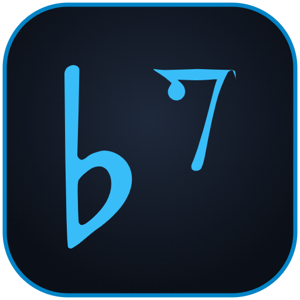

# Dizek 7

**Dizek 7**, Türk Halk Müziği (THM) ve bağlama icrasına özel olarak geliştirilmiş modern, etkileşimli bir nota editörü ve dizgi yazılımıdır.

🔗 **Çevrimiçi Kullanım:** [https://erulmu.github.io/tezene7/](https://erulmu.github.io/tezene7/)

---

## Özellikler

- **Otantik Sarısözen & TRT Standartları:** Türk Halk Müziği koma bemol ($b^2$, $b^1$, $b^3$, $b^7$) ve diyez işaretleri SMuFL (Bravura) standardında eksiksiz desteklenir.
- **Akustik Bağlama & Enstrüman Sesleri:** Nota yazımı sırasında gerçek zamanlı işitsel geri bildirim.
- **Tezene Yönleri & Parmak Numaraları:** Alt/üst tezene vuruşları ve bağlama parmak numaralandırma kuralları.
- **Serbest Ölçü & Aksak Tartımlar:** THM'ye özgü 9/8'lik, 7/8'lik ve serbest pay/payda ölçü sistemleri.
- **A4 Baskı ve Sayfa Önizleme:** Profesyonel nota çıktısı ve PDF yazdırma desteği.
- **Taşınabilir Çalışma:** `dizek7.exe` veya doğrudan web tarayıcısından `dizek7.html` açılarak kurulum gerektirmeden çalıştırılabilir.

## Kullanım

- **Doğrudan Başlatma:** `dizek7.exe` dosyasına çift tıklayarak internetsiz olarak doğrudan açabilirsiniz.
- **Tarayıcıda Çalıştırma:** `dizek7.html` dosyasını indirip herhangi bir modern web tarayıcısında (Chrome, Edge, Firefox vb.) açabilir ya da doğrudan [https://erulmu.github.io/tezene7/](https://erulmu.github.io/tezene7/) adresine giderek kurulum yapmadan tarayıcınızdan kullanabilirsiniz.
